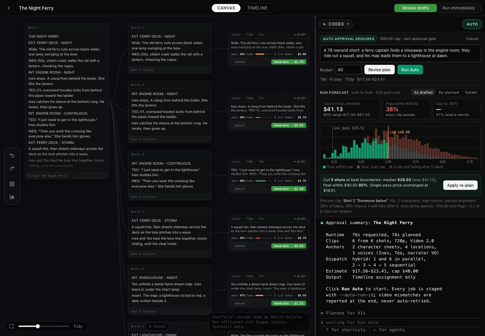
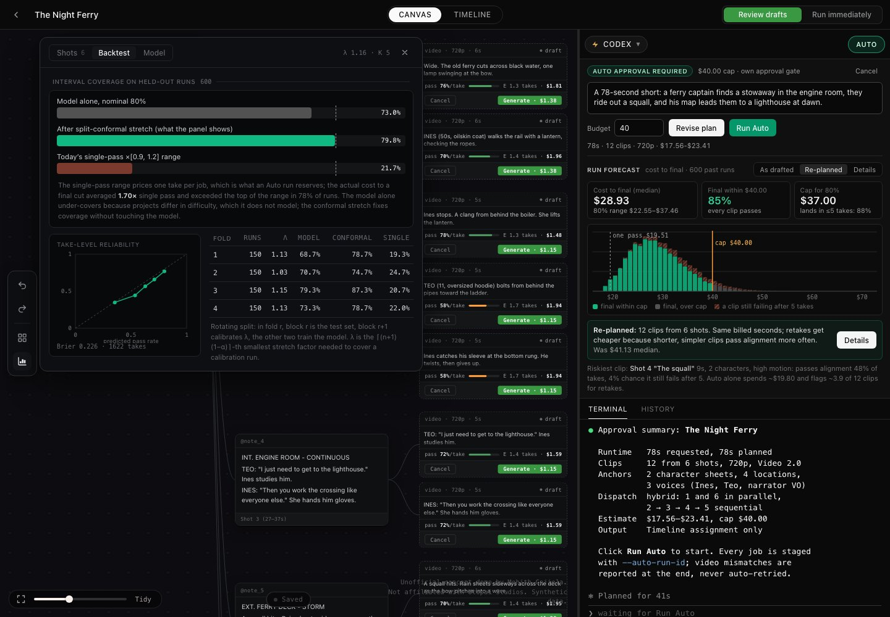

# Run Forecast for PAI-Pro Auto Mode (concept)

**Live demo:** https://mohith26.github.io/utopai-run-forecast/

An unofficial concept feature for [PAI-Pro](https://github.com/Utopai-Research/pai-code) by Utopai Studios, built by Mohith Gajjela. Not affiliated with Utopai Studios. All data is synthetic.



## What it is

When you arm **Auto** in PAI-Pro, the panel shows a rough estimate before you click **Run Auto**: the single-pass price of the plan times 0.9 to 1.2. That is an honest price for what an Auto run *reserves*: one take per clip, images restaged once, videos never auto-retried. It is not what it costs to get a cut where every clip passes the alignment check, because some clips come back as `mismatch` and need retakes after the run.

Run Forecast adds a second number to the same approval gate: **the cost to final**.

- **Cost to final (median and 80% range):** total spend until every clip passes, with up to K takes per clip (default 5).
- **Final within your cap:** the probability that every clip passes *and* the spend stays under the budget you typed.
- **Cap for 80%:** the smallest cap that reaches 80%, or how often a clip still fails after K takes (meaning it needs a rewrite, not more money).
- **Re-plan:** cut shots at their script beats (and/or move them to Video 2.5) to lower the expected cost to final. Each draft pad on the canvas shows the per-take pass rate, expected takes and expected cost for that clip.

In the demo project (*The Night Ferry*, 6 shots, 78 s, 720p) the drafted plan has a $19.51 single-pass price but a **$41.13** median cost to final, and only a **38%** chance of finishing within a $40 cap. Cutting 5 shots at beat boundaries keeps the billed seconds (and the single-pass price) the same, but the median drops to **$28.93** and the chance of finishing within $40 rises to **85%**, because shorter clips with fewer characters and less motion pass alignment more often. All of these numbers are computed in the browser from the synthetic history; none are typed in.

## How it works

1. **Pass model.** Bayesian logistic regression on take history: does a take pass the alignment check, given clip length (linear and squared), characters in frame, motion level, Video 2.5 vs 2.0, resolution, and whether character refs are attached. Gaussian prior, Newton-Raphson MAP fit, Laplace posterior (inverse Hessian). Infra failures (content filter, transient, timeout) are a separate rate: they are billed, because Auto reservations are never refunded, but return no clip. Image and voice anchors get Beta posteriors per kind. In PAI-Pro this data already exists: the agent writes `metadata.alignment.verdict` (`pass` / `mismatch`) on every result node, and `.results/` sidecars record failures.
2. **Exact spend distribution.** For each job, the number of takes is a truncated geometric (retake until pass, at most K). Each job's spend distribution lives on a 1-cent grid, and the jobs are convolved exactly. Two arrays are tracked: total spend, and spend restricted to "every job passed", so P(final and spend ≤ cap) is exact for a given parameter draw. The result is averaged over 64 posterior draws.
3. **Conformal calibration.** The model leaves out project-to-project difficulty (some projects are just harder), so on its own its intervals are too narrow. A split-conformal stretch factor λ is computed on held-out historical runs: the ⌈(n+1)(1−α)⌉-th smallest factor by which each run's interval must be stretched around its median to contain the actual spend. The whole predictive distribution is then stretched by λ, so every probability on the panel comes from the same calibrated distribution.
4. **Re-planning.** For each shot, every way to cut it at its beat boundaries is enumerated, on Video 2.0 and 2.5, within each model's duration limits (2.0: 4-15 s, 2.5: 5-30 s). Expected cost is Σ price × E[takes], with E[takes] = (1 − (1 − s)^K) / s. A plan's expected cost is the sum over its shots (linearity of expectation), so choosing the best option for each shot separately is globally optimal for that objective. A cut must save at least $0.25 in expectation before it is suggested (configurable).

Prices come from PAI-Pro's `server/model_registry.js`: Video 2.0 at $0.11 / $0.23 / $0.57 per billed second (480p / 720p / 1080p), Video 2.5 flat tiers, Image Pro 2K $0.45, Image 2K $0.16, voice $0.01 per 500 characters.

## Backtest (synthetic)

Rotating split over 600 synthetic historical runs (4 folds of 150: test, calibration, and 300 for training):

| Interval | Nominal | Held-out coverage |
|---|---|---|
| Model alone (80% interval) | 80% | 73.0% |
| After the conformal stretch | 80% | 79.8% |
| Today's single pass × [0.9, 1.2] | n/a | 21.7% |

The single-pass range was not designed to cover the cost to final, so that last row is not a criticism of it. It shows the size of the gap: in this synthetic world the actual cost to final averaged 1.70× the single-pass price. The Backtest tab in the demo recomputes all of this live, along with a take-level reliability curve.



## Where it would live

In `AutoModePanel` (`web/src/pages/CanvasView.tsx`), next to the existing estimate line in the `approval_required` phase, and as a strip on staged draft pads (`PendingGenerationNode`). The re-plan would be handed to the agent the same way the approval prompt is today: as part of the approved plan (`buildAutoExecutionPrompt`). The forecast needs only data PAI-Pro already writes.

## Running it

No build step. Serve the folder (the page fetches `data/*.json`):

```
python3 -m http.server 8000
# open http://localhost:8000
```

Tests (Node 20+):

```
node --test tests/forecast.test.mjs
```

The 13 tests cover: generator determinism; prices against the registry; take-distribution identities; grid convolution against brute-force enumeration; recovery of known logistic coefficients; the sign of every fitted driver; linearity (forecast mean = sum of per-job expectations); beat segmentations and duration limits; per-shot optimisation against brute force over all plan combinations; finite-sample coverage of the conformal stretch; consistency of the calibrated quantiles; and the rotating backtest (conformal ≈ nominal, model alone under-covers).

Regenerate data with `node data/generate.mjs` (seeded).

## Honest limitations

- **Synthetic data.** The ground truth that generated the history (longer clips, more characters and more motion fail more often; projects differ in difficulty) is an assumption. The real effect sizes, and whether length even matters for Utopai's models, would have to be fitted from PAI-Pro's actual alignment verdicts. The machinery does not depend on those particular numbers.
- **The alignment verdict is the agent's own self-check**, not the director's approval. Calibrating against what directors actually keep would be better.
- **Takes are treated as independent** given the features. In reality a failed take informs the next prompt, so retake success rates likely go up. A per-project random effect (or updating on the first takes of the run) is the principled next step; the conformal stretch is a model-agnostic patch for that kind of misspecification, and its guarantee is marginal (averaged over runs), not per-project.
- **Cutting a shot is an editorial decision.** The optimiser only proposes cuts at script beats and requires a minimum saving; it cannot judge whether the cut hurts the scene.
- **Video 2.5's flat pricing tiers** mean it rarely wins on cost for shots under 15 s; with these synthetic pass rates the optimiser never picks it for this project.

## Novelty note

As of November 2026 I could not find this in PAI-Pro (code, skills, `PROJECT_AGENT.md`), on Utopai's PAI pages, FAQ or blog, or in other AI video tools. PAI-Pro's estimate is a single-pass count heuristic × [0.9, 1.2]. Vendors and blogs (for example LTX's "How much does AI video generation actually cost?") discuss retake multipliers of 3-10 attempts per usable shot as rules of thumb, and GenflowAI's blog walks through a manual budget worksheet with retry allowances. I did not find a product that forecasts the cost to final from the user's own alignment history, calibrates the interval, or re-plans shots to lower it.
